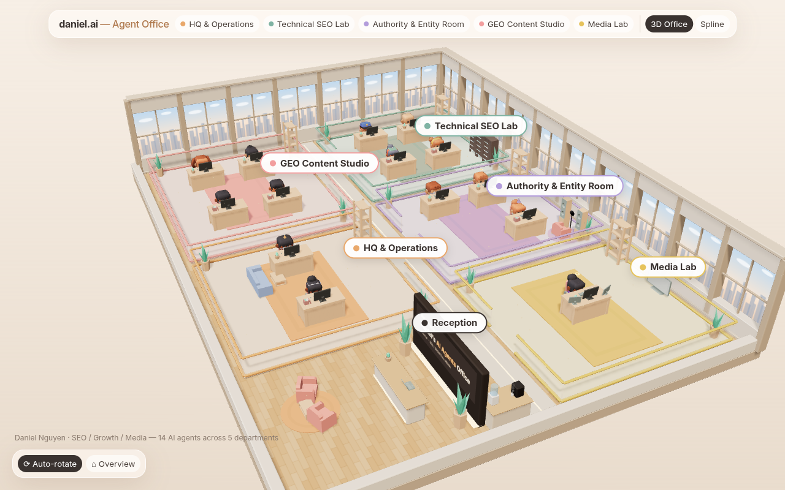

# Daniel's AI Agents Office

An isometric 3D office that shows Daniel Nguyen's 14 AI agents across 5 departments. It's visual only. Built with Three.js 0.160 (loaded from a CDN, so there's no build step), Kenney CC0 models and CSS2D labels.



Live: https://daniel-agent-office.vercel.app · Embed demo: https://daniel-agent-office.vercel.app/embed-demo.html

## Structure
```
index.html        standalone full-screen page (section has data-standalone)
embed-demo.html   example portfolio page with the office as a 70vh section
src/config.js     <- EDIT HERE: rooms, agents, colours, status bubbles
src/main.js       scene, characters, animation, controls
src/office.css    styles, all scoped under #agent-office
src/section.html  markup to paste for a direct include
src/spline.js     optional Spline mode (set SPLINE_URL or ?spline=<url>)
assets/           Kenney Furniture Kit + Mini Characters (CC0), see assets/CREDITS.txt
```

## Editing agents and rooms
Open `src/config.js`. Each room in `DEPTS` has `id, name, color, floor, x, z, w, d` and `agents: [['@handle','role'], ...]`. Optional flags: `rack` (server rack), `mic` (podcast corner), `studio` (extra monitors and a TV). Status bubble texts per room `id` live in `ACT`.

## Embedding in a portfolio
**Option A: iframe (simplest)**
```html
<iframe src="https://daniel-agent-office.vercel.app/" title="Daniel's AI Agents Office"
  style="width:100%;height:70vh;min-height:420px;border:0;border-radius:24px" loading="lazy"></iframe>
```

**Option B: direct include (same page, no iframe)**
1. Add to `<head>`:
```html
<link rel="stylesheet" href="https://daniel-agent-office.vercel.app/src/office.css">
<script type="importmap">{"imports":{"three":"https://unpkg.com/three@0.160.0/build/three.module.js","three/addons/":"https://unpkg.com/three@0.160.0/examples/jsm/"}}</script>
```
2. Paste the contents of `src/section.html` where you want the office.
3. Before `</body>`:
```html
<script type="module" src="https://daniel-agent-office.vercel.app/src/main.js"></script>
<script type="module" src="https://daniel-agent-office.vercel.app/src/spline.js"></script>
```
Assets load relative to `main.js`, so they come from the same host. The section is 70vh with rounded corners and sizes itself to its container. On an embedded page, wheel-zoom only works after you click into the section or while holding Ctrl/Cmd, so normal page scrolling isn't hijacked. Rendering pauses while the section is offscreen or the tab is hidden.

## Performance options
- `?bloom=1` turns on the glow post-processing (off by default).
- `?noaa` turns off MSAA.
- Pixel ratio is capped at 1.25 and shadows are baked once after load.

## Deploy
Static site, no build. `vercel deploy --prod --yes` from this folder, or connect the GitHub repo in Vercel (framework preset: Other, no build command, output dir `.`).

## Credits
3D models: Kenney (kenney.nl), CC0. See `assets/CREDITS.txt`.
